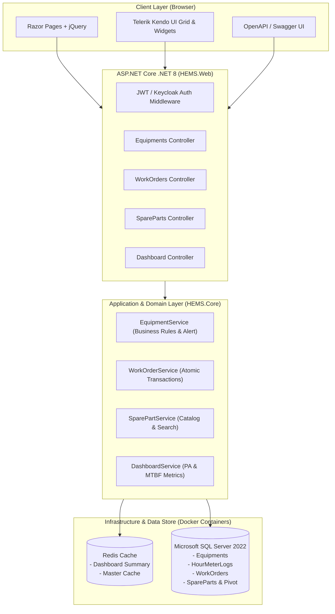
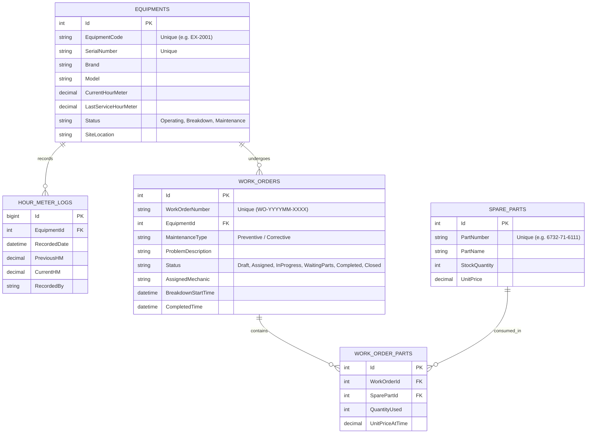
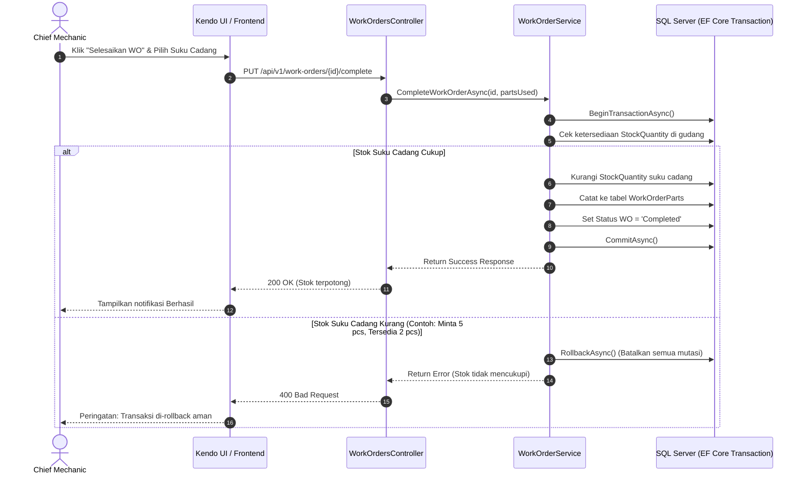

# Heavy Equipment Maintenance & Fleet Management System (HEMS)

[](https://dotnet.microsoft.com/)
[](https://www.microsoft.com/sql-server)
[](https://redis.io/)
[](https://www.telerik.com/kendo-ui)
[-brightgreen.svg)](docs/TESTING_SIT_UAT.md)

**HEMS** adalah sistem back-office manajemen armada alat berat pertambangan dan konstruksi berbasis enterprise. Dirancang menggunakan pola **Clean Architecture** pada ekosistem **C# .NET 8**, **Microsoft SQL Server**, **Redis Distributed Caching**, serta antarmuka dinamis **jQuery & Telerik Kendo UI**.

---

## 🏗️ 1. System Architecture Diagram



---

## 🗄️ 2. Entity Relationship Diagram (ERD)



---

## 🔄 3. Sequence Diagram: Penyelesaian Work Order & Transaksi Suku Cadang (SIT-01)

Diagram alur transaksi atomik penyelesaian tiket perbaikan dan pemotongan inventaris:



---

## 🚀 4. Fitur Utama Sistem

1. **Master Armada & Telematika Hour Meter (HM):**
   - Validasi bisnis ketat: input angka HM baru tidak boleh lebih kecil dari catatan sebelumnya.
   - Peringatan Servis Otomatis (*Preventive Maintenance Alert*) ketika unit mendekati kelipatan 250, 500, 1000, atau 2000 jam kerja mesin.
2. **Siklus Hidup Work Order & Sinkronisasi Armada:**
   - Alur status ketat: `Draft` → `Assigned` → `InProgress` → `WaitingParts` → `Completed` → `Closed`.
   - Pembuatan WO jenis *Breakdown* otomatis mengubah status unit menjadi `Breakdown`. Saat WO ditutup (`Closed`), unit otomatis kembali berstatus `Operating`.
3. **Katalog Suku Cadang & Transaksi Atomik:**
   - Pemotongan stok berbasis transaksi ACID di SQL Server untuk memastikan tidak terjadi inkonsistensi data.
4. **Dashboard Eksekutif & Caching Redis:**
   - Menyajikan metrik **Physical Availability (PA)** dan daftar armada dengan frekuensi kerusakan tertinggi.
   - Hasil query otomatis di-cache ke **Redis** selama 5 menit untuk efisiensi beban query database.
5. **Dokumentasi Pengujian Teruji (SIT & UAT):**
   - Seluruh skenario pengujian integrasi (SIT-01, SIT-02) dan penerimaan pengguna (UAT-01, UAT-02) tersedia dan lulus 100% pada proyek uji `HEMS.Tests`. Rincian lengkap ada di [docs/TESTING_SIT_UAT.md](docs/TESTING_SIT_UAT.md).

---

## 🛠️ 5. Panduan Menjalankan Proyek

### Prasyarat
- **.NET 8 SDK**
- **Docker Desktop**

### Langkah 1: Jalankan Infrastruktur Database & Cache (Docker)
```powershell
docker compose up -d
```
Container `hems-sqlserver` (port 1433) dan `hems-redis` (port 6379) akan aktif.

### Langkah 2: Jalankan Automated Unit & Integration Tests
```powershell
dotnet test
```

### Langkah 3: Jalankan Aplikasi Web & API
```powershell
dotnet run --project src/HEMS.Web
```

Akses melalui browser:
- **Executive Fleet Dashboard:** `http://localhost:5236/`
- **Manajemen Work Order:** `http://localhost:5236/WorkOrders`
- **Katalog Suku Cadang:** `http://localhost:5236/SpareParts`
- **Interactive Swagger REST API:** `http://localhost:5236/swagger`
